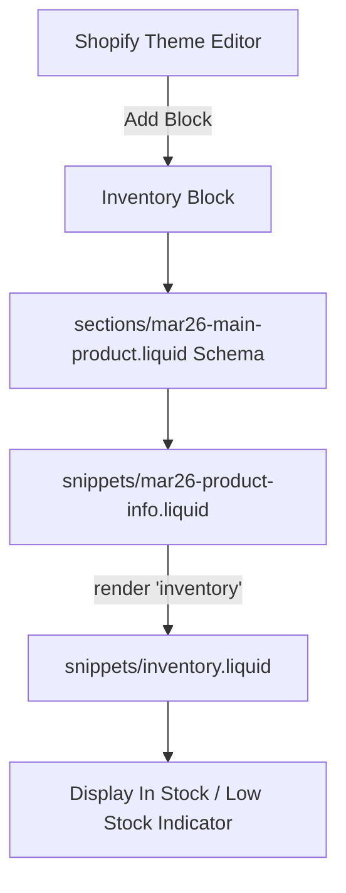

# Inventory Block in Top Product Info Blueprint (`blueprint.md`)

This blueprint details the plan to add an **`inventory`** block to `sections/mar26-main-product.liquid` and `snippets/mar26-product-info.liquid` so merchants can add stock indicator badges (e.g. "In stock", "Low stock - 3 left") inside **Top Product Info**, matching Impact theme defaults.

---

## 1. Goal & Architecture

Support the native Impact theme `inventory` block inside `sections/mar26-main-product.liquid` and `snippets/mar26-product-info.liquid`.



---

## 2. Technical Modifications

### A. Schema Update (`sections/mar26-main-product.liquid`)
Add the `inventory` block definition to `blocks` array:

```json
{
  "type": "inventory",
  "name": "Inventory",
  "limit": 1,
  "settings": [
    {
      "type": "range",
      "id": "low_inventory_threshold",
      "label": "Low inventory threshold",
      "info": "Use low stock color when quantity is below the threshold. Choose 0 to always show in stock.",
      "min": 0,
      "max": 100,
      "step": 1,
      "default": 0
    }
  ]
}
```

### B. Liquid Rendering Update (`snippets/mar26-product-info.liquid`)
Add `when 'inventory'` case inside the block loop:

```liquid

  <div class="product-info__inventory" {{ block.shopify_attributes }}>
    
  </div>
```

---

## 3. Verification Plan

1. Open Theme Editor for `bt-brooms`.
2. Inside **Top Product Info**, click **Add block** and select **Inventory**.
3. Move the Inventory block above or below the buy buttons.
4. Verify stock indicator badge displays correctly (e.g., green dot "In stock" or red dot "Low stock").
