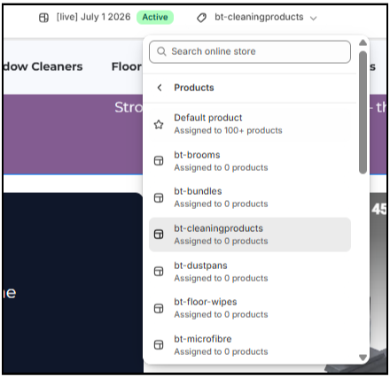
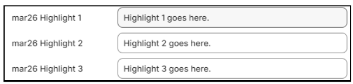

# Store Updates & Theme Editor User Guide

## System Updates Overview
All updates have been implemented directly across your theme sections, snippets, and product templates. Changes focus on editor organization, responsive layout adjustments, and automated product content population.

## Start Here:
- Open the Theme Editor (**Online Store > Themes > Customize**).
- Using the top navigation bar dropdown, go to **Products > bt-brooms** (or any `bt-*` custom template like `bt-bundles`, `bt-mops`, `bt-squeegees`, etc.).
- To connect a product to a template: Open **Shopify Admin > Products > [Product]**, set the right-side **Theme template** dropdown to `bt-brooms` (or corresponding `bt-*` template), and click **Save**.

---

# SECTION: Product Page Variations & Templates

### Action Summary:
- **Catalog-Aligned Templates**: Established active template structure for 10 custom product templates matching the 10 `-bt` collection categories (`bt-brooms`, `bt-bundles`, `bt-mops`, `bt-dustpans`, etc.).
- **Mandatory Anchors**: Enforced 2 mandatory anchor sections across all templates: Top Product Info and Footer.
- **Standardized Flow**: Synchronized rendering order across templates: Top Product Info → Video → Better Cleaning → Q&A → Built-Different → What's Included → Testimonials → Best-Sellers → Footer.

### 👉 How to Use It / Test It:
- Go to **Shopify Admin > Products > [Select Product]**.
- Change **Theme template** in the right sidebar dropdown to the corresponding template.

---

# SECTION: Top Product Info (aka 'Product Card', the top section of each product)

### Action Summary:
- **Renamed Section**: Display name changed from "MAR26 Product page" to "Top Product Info" in the left sidebar menu for clearer navigation.
- **Inline Quantity Selector**: Reintroduced the `- 1 +` quantity stepper on the exact same horizontal row as the Add to Cart button on desktop screens.
- **Responsive Mobile Stacking**: On mobile screens (< 1000px), quantity stepper, Add to Cart, and express checkout buttons automatically stack vertically at 100% full width (1 per line).
- **Automated Bullet Highlights**: Updated short description card to automatically pull `mar26 Highlight 1`, `2`, and `3` metafields from the Shopify product admin page.
- **Inventory Display**: Added the inventory stock display block (you can reposition it freely).

### 👉 How to Use It / Test It:
1. Open **Shopify Admin > Products > [Select Product]**.
2. In the right sidebar under **Theme template**, select `bt-brooms` (or target `bt-*` template).
3. Scroll down to **Metafields** and enter text in `mar26 Highlight 1`, `Highlight 2`, and `Highlight 3`.
4. Click **Save**.

---

# SECTION: Testimonials

### Action Summary:
- **Centered Rating Badge**: Positioned a 5-star rating icon stack centered directly above the section title and subheading.
- **Product Link Badges**: Added product picker binding to review card blocks, rendering a clickable product tag badge on each review card with a subtle hover animation.
- **Dynamic Product Titles**: Leaving the custom product name field blank automatically displays the real title of the connected Shopify product.

### 👉 How to Use It / Test It:
1. Open Theme Editor (**Online Store > Themes > Customize**).
2. Select **MAR26 Testimonials** in the left sidebar.
3. Click an individual **Testimonial Card** block.
4. Select a product in the **Product** picker field.
5. *(Optional)* Leave **Custom Product Name** empty to automatically display the product's actual title, or enter custom text to override it.

---

# SECTION: What's Included

### Action Summary:
- **Direct Product Connection**: Added an optional **Product** picker setting to each item block in Theme Editor.
- **Automated Content Resolution**: Connecting a product automatically pulls its main image, title, short description strictly from `custom.short_description`, and bullet highlights (`mar26 Highlight 1`, `2`, `3`).
- **Product Reference List Support**: Added support for `custom.included_products` metafield to render bundle cards automatically without creating blocks manually.
- **Manual Overrides**: Entering manual text or images in Theme Editor block settings overrides product defaults.

### 👉 How to Use It / Test It:
- **Option A (Theme Editor)**: Open **MAR26 What's Included**, click an **Included Item** block, and select a product in the **Product** picker.
- **Option B (Shopify Admin Metafields)**: Open **Shopify Admin > Products > [Bundle Product]**, scroll to Metafields, and select items inside **Included Products** (`custom.included_products`).

---

# SECTION: Metafields & Custom Data

### Action Summary:
- **Feature Video Slots**: Registered `custom.product_video` (Desktop) and `custom.mobile_product_video` (Mobile) to stream hosted `.mp4` feature videos.

### 👉 How to Use It / Test It:
1. Open **Shopify Admin > Products > [Select Product]**.
2. Scroll down to **Metafields**.
3. Under **Product Video (Desktop)** and **Mobile Product Video**, upload or select your `.mp4` video files.
4. Save the product page. Videos will stream in your product showcase sections automatically.
